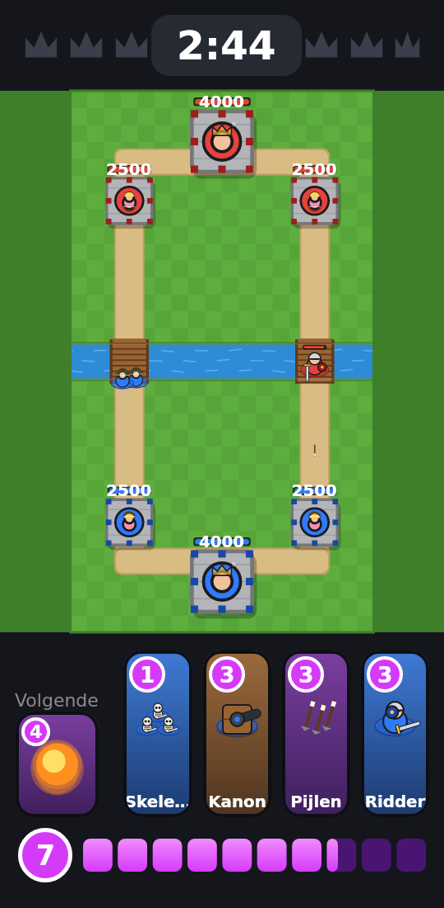
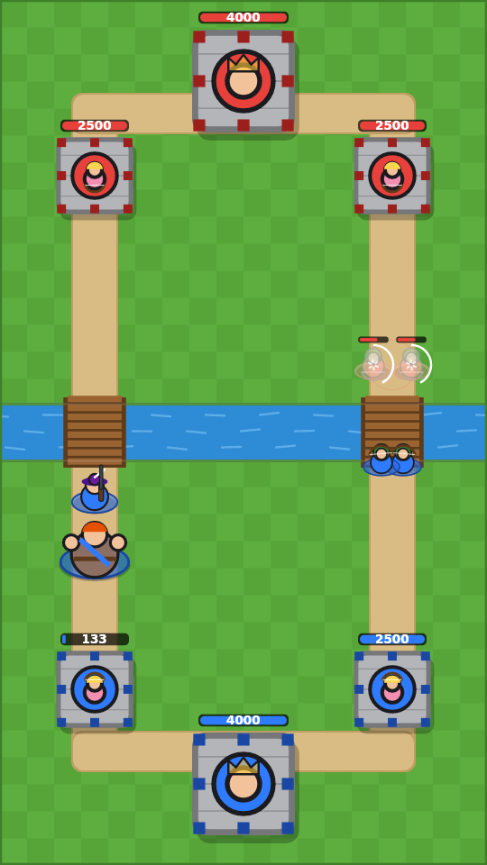

# Skill Arena

Een Android-game met de mechanics van Clash Royale, maar **zonder levels**.
Net als bij schaken heeft iedereen exact dezelfde stukken: elke kaart is vanaf het begin
beschikbaar en heeft voor iedereen dezelfde stats. Winnen hangt alleen af van je beslissingen.

<p>
  
  
</p>

## Wat zit erin

| Mechanic | Hoe |
|---|---|
| Arena 18×32 tiles, rivier, 2 bruggen | `core/.../arena/Arena.kt` |
| 2 prinsessentorens + koningstoren (slaapt tot hij geraakt wordt) | `Match.kt` |
| Elixir: start 5, max 10, 1 per 2,8 s; 2× in de laatste minuut, 2×/3× in overtime | `MatchConfig.kt` |
| Deck van 8, hand van 4, kaartcyclus met "volgende kaart" | `PlayerState.kt` |
| Troepen, gebouwen (vervallen over tijd) en spreuken (met vluchttijd) | `cards/` |
| Lucht/grond, "alleen gebouwen"-targeting, splash, deploy-tijd | `UnitStats.kt` |
| Pocket-plaatsing na het nemen van een toren | `Match.canPlaceAt` |
| 3 min + 2 min sudden death, daarna tiebreak op laagste torenhp | `Match.updateClock` |
| Elo-rating + matchmaking op rating (zoals schaken) | `rating/Elo.kt` |
| Bot-tegenstander | `ai/Bot.kt` |
| Replays | `match/Replay.kt` |
| Graphics: getekende troepen/torens, projectielen, explosies, vloeiende beweging | `app/.../ui/render/` |

## Geen levels, alleen skill

- `CardCatalog` is de enige bron van stats. Er bestaat geen kaartlevel, upgrade of torenlevel.
- Balans aanpassen = de getallen in `CardCatalog` wijzigen, voor iedereen tegelijk.
- Er is geen willekeur in gevechten (geen crits, geen missers). De enige seed bepaalt alleen de
  startvolgorde van je deck.
- Progressie is je **Elo-rating**, niet je collectie.

## Graphics

Alles wordt getekend met code (geen plaatjes nodig), in `app/src/main/java/com/skillarena/app/ui/render/`:

- `Sprites.kt` – elke kaart en toren heeft een eigen tekening. Een nieuwe kaart? Voeg een functie toe en
  koppel hem in `drawUnitSprite`.
- `Effects.kt` – pijlen, kogels, kanonskogels, vuurballen, explosies, rookwolkjes en schermschudden.
- `BattleRenderer.kt` – zet alles samen. Units bewegen vloeiend doordat er tussen twee ticks wordt
  geïnterpoleerd (`Entity.prevPos` → `Entity.pos`).
- `ArenaBackground.kt` – gras, zandpaden, bewegend water en houten bruggen.

## Architectuur

```
core/   Pure Kotlin game-engine (geen Android). Deterministisch, volledig testbaar.
app/    Android-app (Jetpack Compose) die de engine tekent en input doorgeeft.
```

De engine draait in vaste ticks (20 per seconde). Spelers beïnvloeden een wedstrijd
**alleen** via `Command`s (`PlayCard`). Dezelfde seed + decks + commands geven altijd exact
hetzelfde resultaat. Daardoor krijg je gratis:

- **Replays**: sla `Replay` op (seed, decks, commands) en speel opnieuw af.
- **Multiplayer (lockstep)**: beide telefoons simuleren zelf en wisselen alleen commands uit,
  met een paar ticks vertraging. `Match.stateHash()` detecteert desyncs.
- **Anti-cheat**: een server kan een replay na-simuleren en de uitslag controleren.

Belangrijkste API:

```kotlin
val match = Match(listOf(Deck.STARTER, Deck.AGGRO), seed = 42)
match.playCard(player = 0, cardId = "giant", pos = Vec2(3.5f, 12f))
match.step()                 // 1 tick
match.entities               // alles om te tekenen
match.drainEvents()          // voor geluid/animaties
match.result                 // != null als de wedstrijd klaar is
```

## Bouwen

- **App**: open de map in Android Studio en run `app`, of `./gradlew :app:assembleDebug`.
- **Alleen de engine + tests** (geen Android SDK nodig): `./gradlew -PcoreOnly :core:test`
- GitHub Actions bouwt bij elke push de tests en een debug-APK (zie het tabblad *Actions*).

## Volgende stappen

1. **Deckbuilder-scherm** – kies 8 kaarten uit `CardCatalog.ALL` (`Deck` valideert al).
2. **Online multiplayer** – een kleine relay-server die `PlayCard`-commands doorstuurt
   (lockstep), plus server-side `Replay`-validatie.
3. **Rating opslaan** – nu staat de Elo alleen in het geheugen; zet het in DataStore of op de server.
4. **Geluid** – geluidseffecten koppelen aan `GameEvent`s (aanval, spreuk, toren kapot).
5. **Meer kaarten en mechanics** – bijv. spawners, charge-aanvallen, knockback,
   een `onDeath`-effect. Voeg een veld toe aan `UnitStats` en verwerk het in `Match.updateEntity`.
6. **Pathfinding verfijnen** – units lopen nu via de dichtstbijzijnde brug en duwen elkaar weg;
   echte obstakel-pathfinding rond torens is een verbetering.
